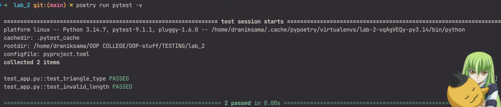
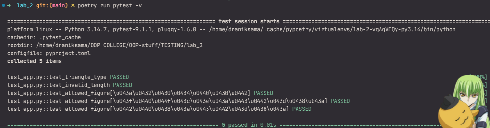
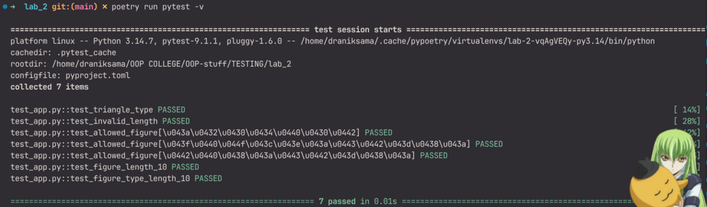
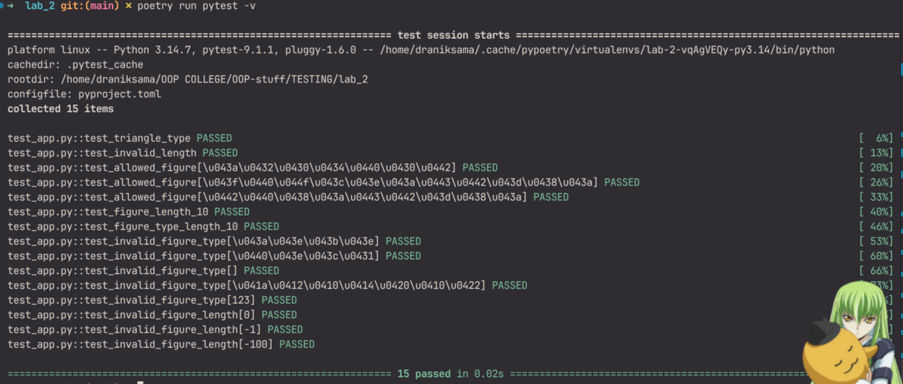
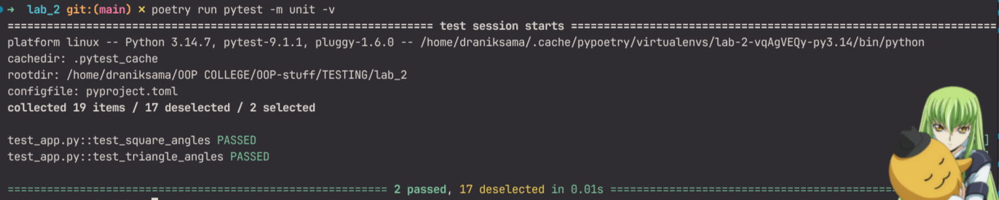
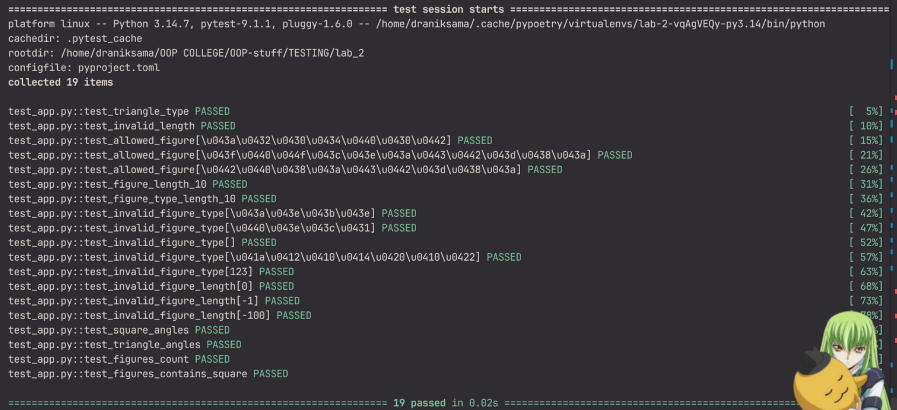

# Звіт до роботи
## Тема: Тестування з бібліотекою pytest
### Мета роботи: _Навчитись писати тести за допомогою pytest, використовувати параметризацію, fixtures та маркери_

---
### Виконання роботи

#### Встановлення pytest
```bash
poetry add --group dev pytest
```

#### Запуск тестів
```bash
poetry run pytest -v
```


#### 1. Параметризований тест для всіх дозволених фігур
Додав параметризований тест, який перевіряє що кожна фігура зі списку `FIGURES` створюється коректно:
```python
@pytest.mark.parametrize("figure_type", Figure.FIGURES)
def test_allowed_figure(figure_type):
    assert Figure(figure_type, 1).type == figure_type
```


#### 2. Fixture з довжиною 10
Додав fixture яка повертає фігуру з довжиною 10 та два тести для перевірки її властивостей:
```python
@pytest.fixture
def figure_length_10():
    return Figure("квадрат", 10)

def test_figure_length_10(figure_length_10):
    assert figure_length_10.get_figure_length == 10

def test_figure_type_length_10(figure_length_10):
    assert figure_length_10.type == "квадрат"
```


#### 3. Тести для некоректних даних
Додав параметризовані тести для кожного неправильного типу фігури та кожного неправильного значення довжини:
```python
@pytest.mark.parametrize("invalid_type", ["коло", "ромб", "", "КВАДРАТ", 123])
def test_invalid_figure_type(invalid_type):
    with pytest.raises(AssertionError):
        Figure(invalid_type, 5)

@pytest.mark.parametrize("invalid_length", [0, -1, -100])
def test_invalid_figure_length(invalid_length):
    with pytest.raises(AssertionError):
        Figure("квадрат", invalid_length)
```


#### 4. Маркер `unit`
Додав маркер `unit` до двох тестів та зареєстрував його у `pyproject.toml`:
```toml
[tool.pytest.ini_options]
markers = [
    "unit: швидкі юніт-тести",
]
```
```python
@pytest.mark.unit
def test_square_angles():
    assert Figure("квадрат", 5).get_angles() == 4

@pytest.mark.unit
def test_triangle_angles():
    assert Figure("трикутник", 5).get_angles() == 3
```
Запуск тільки тестів з маркером:
```bash
poetry run pytest -m unit -v
```


#### 5. Fixture зі `scope="module"`
Fixture зі `scope="module"` створюється один раз для всього модуля, а не окремо для кожного тесту. Підходить для даних які не змінюються:
```python
@pytest.fixture(scope="module")
def allowed_figures():
    return Figure.FIGURES

def test_figures_count(allowed_figures):
    assert len(allowed_figures) == 3

def test_figures_contains_square(allowed_figures):
    assert "квадрат" in allowed_figures
```


---

### Різниця між `unittest.TestCase` та функцією `pytest`

| | `unittest.TestCase` | `pytest` |
|---|---|---|
| Структура | Клас що наслідує `TestCase` | Звичайна функція |
| Перевірки | `assertEqual`, `assertTrue` тощо | Звичайний `assert` |
| Встановлення | Вбудований модуль | Стороння бібліотека |
| Параметризація | Потребує сторонніх бібліотек або ручного циклу | Вбудований `@pytest.mark.parametrize` |

### Висновок
Навчився писати тести з pytest: базові перевірки через `assert`, параметризацію для кількох наборів даних, fixtures для підготовки тестових об'єктів та маркери для групування тестів.