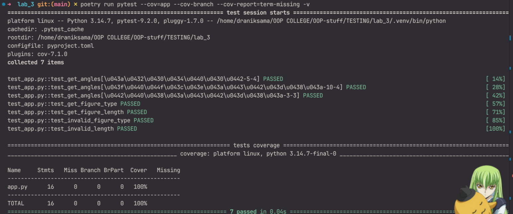
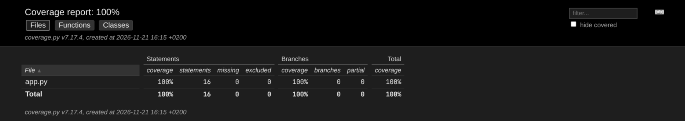

# Звіт до роботи
## Тема: Покриття коду (Coverage)
### Мета роботи: _Навчитись вимірювати покриття коду тестами, використовувати coverage.py та pytest-cov, розуміти різницю між line та branch coverage_;
 
---
### Виконання роботи
 
#### Встановлення залежностей
```bash
poetry add --group dev coverage pytest pytest-cov
```
 
#### Написання тестів
Написав тести для класу `Figure` з `app.py`, які покривають конструктор (коректні та некоректні дані), обидві властивості та метод `get_angles()` для всіх типів фігур:
```python
import pytest
from app import Figure
 
 
@pytest.mark.parametrize("figure_type, length, expected_angles", [
    ("квадрат", 5, 4),
    ("прямокутник", 10, 4),
    ("трикутник", 3, 3),
])
def test_get_angles(figure_type, length, expected_angles):
    figure = Figure(figure_type, length)
 
    assert figure.get_angles() == expected_angles
 
 
def test_get_figure_type():
    figure = Figure("квадрат", 5)
 
    assert figure.get_figure_type == "квадрат"
 
 
def test_get_figure_length():
    figure = Figure("прямокутник", 10)
 
    assert figure.get_figure_length == 10
 
 
def test_invalid_figure_type():
    with pytest.raises(AssertionError, match="Невідомий тип фігури"):
        Figure("коло", 5)
 
 
def test_invalid_length():
    with pytest.raises(AssertionError, match="Довжина має бути більшою за 0!"):
        Figure("квадрат", 0)
```
 
#### Запуск тестів з coverage
```bash
poetry run pytest --cov=app --cov-branch --cov-report=term-missing -v
```

 
Coverage склав **100%**, у стовпці `Missing` непокритих рядків немає.
 
#### Порівняння покриття до і після додавання тестів
- **До:** були лише тести на некоректні дані та `get_angles` для одного типу фігури. Властивості `get_figure_type` і `get_figure_length`(12, 19-24) не викликались, тому їхні рядки були у `Missing`, покриття складало **81%**.
- **Після:** додані тести властивостей і параметризований тест для всіх трьох фігур. Покриття — **100%**.
#### pragma: no cover
Не використовував. Усі рядки `app.py` досяжні й покриті тестами, а точки входу скрипта (`if __name__ == "__main__"`) у файлі немає. Додавати `pragma: no cover` лише для підвищення відсотка некоректно.
 
#### Налаштування .coveragerc
```ini
[run]
source = .
branch = true
 
[report]
omit =
    test_*.py
    */__init__.py
    */.venv/*
```
- `source = .` — аналіз Python-файлів у поточній папці;
- `branch = true` — вмикає перевірку переходів між гілками;
- `omit` — прибирає зі звіту тести та службові файли, тож у звіті лишається лише `app.py`.
#### HTML- та XML-звіти
```bash
poetry run coverage html
poetry run coverage xml
```

 
HTML-звіт призначений для людей — його зручно переглядати у браузері (`htmlcov/index.html`), він підсвічує виконані та непокриті рядки. XML-звіт (`coverage.xml`) призначений для CI-систем та сервісів аналізу покриття.
 
#### Різниця між line та branch coverage
- **Line coverage** — показує, чи виконувався рядок хоча б раз.
- **Branch coverage** — показує, чи пройшли тести кожен напрямок умовного переходу (`if/else`). Наприклад, якщо протестувати лише одну фігуру, рядок з умовою виконається, але гілки для інших типів залишаться непокритими за branch coverage.
У моєму коді `get_angles` використовує словник, а не `if/elif`, тому розгалужень у ньому немає і обидва види покриття збігаються.
 
#### Чого coverage не доводить
100% line coverage не означає відсутності помилок. Тест, який викликає функцію без `assert`, збільшує відсоток покриття, але не перевіряє правильність результату:
```python
def test_get_angles_no_assert():
    Figure("квадрат", 5).get_angles()
```
Такий тест не помітить помилку, навіть якщо метод поверне неправильне число. Лише з `assert figure.get_angles() == 4` тест реально гарантує коректність.
 
#### .gitignore
```
__pycache__/
.coverage
htmlcov/
.pytest_cache/
```
 