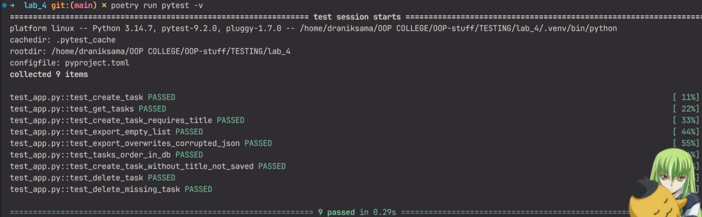

# Звіт до роботи
## Тема: Інтеграційне тестування
### Мета роботи: _Навчитись писати інтеграційні тести для Flask-застосунку, який працює з SQLite та файловою системою, використовуючи тестовий клієнт Flask і тимчасові ресурси `tmp_path`_;

---
### Виконання роботи

#### Встановлення залежностей і запуск тестів
```bash
poetry add --group dev flask pytest
poetry run pytest -v
```

#### Опис застосунку
Невеликий Flask-застосунок для керування завданнями:
- `POST /tasks` — створює завдання, зберігає його в SQLite і експортує весь список у JSON-файл;
- `GET /tasks` — повертає список завдань з бази;
- `DELETE /tasks/<int:task_id>` — видаляє завдання з бази та оновлює JSON-файл (додано у межах завдання :fire:).

Функція `init_db` створює таблицю `tasks`, а `export_tasks` записує завдання у JSON.

#### Підготовка тестів
Для кожного тесту fixture `resources` створює тимчасову папку `tmp_path`, у ній окрему базу `tasks.db` та файл `tasks.json`, і повертає тестовий клієнт Flask. Робоча база не використовується, mock-об'єкти не застосовуються, а після тесту тимчасові файли видаляються автоматично.
```python
@pytest.fixture
def resources(tmp_path):
    db_path = tmp_path / "tasks.db"
    export_path = tmp_path / "tasks.json"
    app = create_app(db_path, export_path)
    return app.test_client(), db_path, export_path
```

#### Тестування файлів
```python
def test_export_empty_list(resources):
    _, db_path, export_path = resources

    export_tasks(db_path, export_path)

    assert json.loads(export_path.read_text(encoding="utf-8")) == []


def test_export_overwrites_corrupted_json(resources):
    client, db_path, export_path = resources
    client.post("/tasks", json={"title": "Завдання"})
    export_path.write_text("{ це не json", encoding="utf-8")

    export_tasks(db_path, export_path)

    data = json.loads(export_path.read_text(encoding="utf-8"))
    assert [task["title"] for task in data] == ["Завдання"]
```
- `test_export_empty_list` — для порожньої бази експорт створює файл з порожнім списком `[]`;
- `test_export_overwrites_corrupted_json` — пошкоджений файл повністю перезаписується коректним JSON.

#### Тестування бази даних
```python
def test_tasks_order_in_db(resources):
    client, db_path, _ = resources

    client.post("/tasks", json={"title": "Перше"})
    client.post("/tasks", json={"title": "Друге"})

    with sqlite3.connect(db_path) as connection:
        rows = connection.execute("SELECT id, title FROM tasks ORDER BY id").fetchall()
    assert rows == [(1, "Перше"), (2, "Друге")]
```
Тест перевіряє не відповідь сервера, а фактичний вміст таблиці SQLite: два завдання збережені у порядку створення.

#### Тестування вебзастосунку
```python
def test_create_task_without_title_not_saved(resources):
    client, db_path, _ = resources

    response = client.post("/tasks", json={})

    assert response.status_code == 400
    assert "error" in response.get_json()
    with sqlite3.connect(db_path) as connection:
        count = connection.execute("SELECT COUNT(*) FROM tasks").fetchone()[0]
    assert count == 0
```
Перевіряються статуси відповідей:
- `201` — завдання створено (`test_create_task`);
- `200` — список отримано (`test_get_tasks`);
- `400` — запит без поля `title`, у базу нічого не записано.

#### Додатковий маршрут DELETE
```python
@app.delete("/tasks/<int:task_id>")
def delete_task(task_id: int):
    with sqlite3.connect(db_path) as connection:
        cursor = connection.execute("DELETE FROM tasks WHERE id = ?", (task_id,))
    if cursor.rowcount == 0:
        return jsonify({"error": "Завдання не знайдено"}), 404
    export_tasks(db_path, export_path)
    return jsonify({"deleted": task_id}), 200
```
```python
def test_delete_task(resources):
    client, db_path, export_path = resources
    client.post("/tasks", json={"title": "Перше"})
    client.post("/tasks", json={"title": "Друге"})

    response = client.delete("/tasks/1")

    assert response.status_code == 200
    with sqlite3.connect(db_path) as connection:
        rows = connection.execute("SELECT id, title FROM tasks").fetchall()
    assert rows == [(2, "Друге")]
    data = json.loads(export_path.read_text(encoding="utf-8"))
    assert [task["title"] for task in data] == ["Друге"]
```
Тест перевіряє, що після видалення запис зник і з бази, і з JSON-файла. Для неіснуючого `id` маршрут повертає `404` (`test_delete_missing_task`).

#### Результат виконання pytest
```bash
poetry run pytest -v
```


Усі 9 тестів пройшли успішно.

#### Які компоненти взаємодіють у тестах
| Тест | Компоненти |
|---|---|
| `test_create_task` | HTTP-маршрут → SQLite → JSON-файл |
| `test_get_tasks` | HTTP-маршрут → SQLite |
| `test_create_task_requires_title` | HTTP-маршрут → валідація → файлова система (файл не створюється) |
| `test_export_empty_list` | SQLite → `export_tasks` → JSON-файл |
| `test_export_overwrites_corrupted_json` | SQLite → `export_tasks` → JSON-файл |
| `test_tasks_order_in_db` | HTTP-маршрут → SQLite |
| `test_create_task_without_title_not_saved` | HTTP-маршрут → валідація → SQLite |
| `test_delete_task` | HTTP-маршрут → SQLite → JSON-файл |
| `test_delete_missing_task` | HTTP-маршрут → SQLite |

#### Юніт-тест та інтеграційний тест
- **Юніт-тест** перевіряє одну функцію ізольовано (наприклад, лише `export_tasks` з підставною базою).
- **Інтеграційний тест** перевіряє спільну роботу кількох компонентів: у нашому випадку HTTP-запит, бізнес-логіку, реальну SQLite-базу і файл на диску.
- **Системний тест** перевіряє програму майже так, як її використовує кінцевий користувач (запущений сервер, реальні запити).

Тут бази й файли справжні, лише тимчасові, тому тести виявляють помилки на стиках компонентів, які юніт-тести з mock-об'єктами не помітили б.