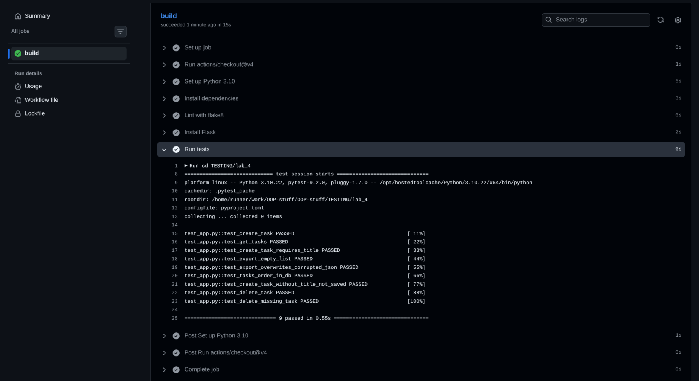

[](https://github.com/Gonflik/OOP-stuff/actions/workflows/manual.yml)
[](https://github.com/Gonflik/OOP-stuff/actions/workflows/python-app.yml)

# Звіт до роботи
## Тема: Автоматизація за допомогою GitHub Actions
### Мета роботи: _Навчитись налаштовувати GitHub Actions: створювати Workflow з шаблону, запускати його вручну та за розкладом, використовувати декілька Workflow, завдань, умови та статус-баджі_;

Репозиторій: https://github.com/Gonflik/OOP-stuff

---
### Виконання роботи

### 1. Workflow з шаблону
Створив Workflow `laba5_dranik` з шаблону `Python application`. Замість кроку `pytest` на весь репозиторій додав кроки, які запускають тести лабораторної №4:
```yaml
- name: Install Flask
  run: |
    pip install flask pytest

- name: Run tests
  run: |
    cd TESTING/lab_4
    pytest -v
```
Workflow запускається при кожному `push` та `pull_request` у `main`.



### 2. Ручний запуск та запуск за розкладом
Другий Workflow `Manual workflow` (`manual.yml`) має два тригери:
- `workflow_dispatch` додано для ручного запуску з вхідним параметром `name` (за замовчуванням `Executer`);
- `schedule` з `cron` додано для автоматичного запуску за розкладом.

```yaml
on:
  workflow_dispatch:
    inputs:
      name:
        description: "Ім'я виконавця"
        required: false
        default: "Executer"
  schedule:
    - cron: '0 14 * * 3'
```
Вираз `0 14 * * 3` означає запуск щосереди о 14:00 за UTC (16:00 за київським часом). Розклад змінений відносно прикладу (щодня о 9:00) на інший день тижня та іншу годину. Щоб не витрачати безкоштовні хвилини, Workflow запускався вручну.


### 3. Декілька Workflow
У `.github/workflows/` два файли, кожен є окремим Workflow зі своєю назвою (`name`):


### 4. Декілька завдань
`Manual workflow` містить два завдання, `Run first Job` та `Run Second Job`, які виконуються незалежно одне від одного:


### 5. Умова виконання кроку
Директиву `if` додано до кроку привітання, щоб він виконувався лише коли передано власне ім'я:
```yaml
- name: Send greeting
  if: github.event.inputs.name != 'Executer'
  run: echo "Hello ${{ github.event.inputs.name }}"
```
Запуск із значенням за замовчуванням `Executer`, крок пропущено:


Запуск з власним іменем, крок виконано:


### 6. Баджі
Додав статус-баджі обох Workflow на початок `README.md`, щоб на головній сторінці репозиторію було видно результат виконання:
